

  

  
  
  
  
  
  
  

  <a href="#-contexte">Contexte</a> ·
  <a href="#-la-chaîne-de-traitement">Chaîne de traitement</a> ·
  <a href="#-linterface">Interface</a> ·
  <a href="#-notation-des-photos">Notation</a> ·
  <a href="#-restitution-dans-le-sig">SIG</a> ·
  <a href="#-résultats">Résultats</a> ·
  <a href="#-stack-technique">Stack</a> ·
  <a href="#-évolutions">Évolutions</a>

---

Outil de bureau qui automatise **toute la chaîne de traitement des photos d'inspection** prises par un drone dans les réseaux d'assainissement : de la récupération des images sur Google Drive jusqu'à leur **remontée en pièces jointes sur les tronçons dans ArcGIS Enterprise**, avec un tableau de bord de suivi des notes.

Ce projet a été mon **sujet de mémoire de Master 2** (Master G2M, Université Paris 8), réalisé pendant mon alternance chez **Veolia Assainissement & Maintenance France** (anciennement **SARP**, Société d'Assainissement Rationnel et de Pompage), à Gonesse. Je l'ai ensuite fait évoluer en tant que chargé de projet géomatique. L'outil est utilisé en production et distribué sous forme d'**exécutable Windows** à des opérateurs sans compétence en programmation.

> [!NOTE]
> Ce dépôt est une **vitrine** du projet : le code source appartient à l'entreprise et n'est pas publié. Vous y trouverez l'architecture, le fonctionnement, des captures de l'interface et des exemples de résultats.

  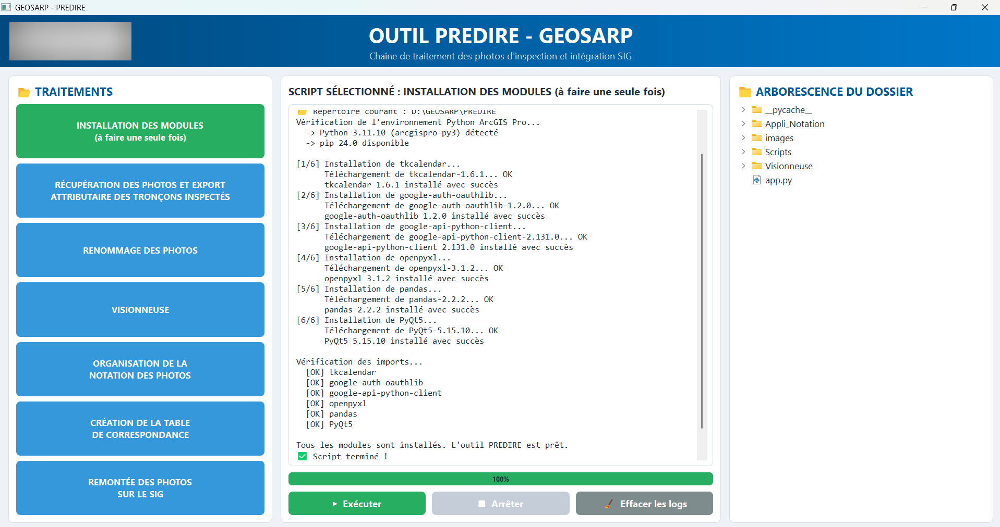
   L'interface pendant l'exécution d'une étape : journal en temps réel, barre de progression et arborescence du dossier de travail.

---

## 🎯 Contexte

Les réseaux d'assainissement sont anciens, enterrés et difficiles à surveiller. Le **prédiagnostic** consiste à évaluer rapidement leur état **sans curage ni inspection télévisée (ITV) lourde**, pour cibler ensuite les tronçons qui en ont vraiment besoin.

Un **drone terrestre autonome** est envoyé dans les canalisations (Ø 200 à 250 mm). Il avance seul, franchit les obstacles et prend **une photo toutes les 10 secondes**. Sur une campagne de **100 km de réseau**, cela représente des milliers d'images à trier, renommer, noter, puis rattacher au bon tronçon.

**Le problème :** ce traitement était entièrement manuel. Copier les photos depuis le Drive, filtrer les tronçons du jour dans le portail, renommer image par image, créer les dossiers par note, construire les livrables… Long, répétitif, et source d'erreurs (photos rattachées au mauvais tronçon, oublis, doublons).

**L'objectif :** une interface unique qui enchaîne toutes ces étapes en quelques clics, fiable, et utilisable par n'importe quel agent.

---

## 🔄 La chaîne de traitement

  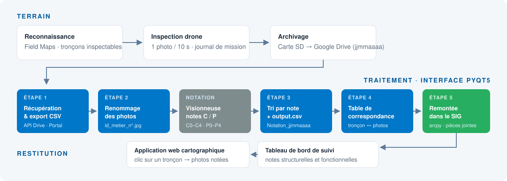

| # | Étape | Ce qu'elle fait | Entrées → sorties |
|:-:|---|---|---|
| 1 | **Récupération des photos & export attributaire** | L'agent choisit la **date de la mission dans un calendrier** intégré à l'interface. L'outil télécharge les photos de cette mission via l'**API Google Drive**, crée le dossier daté, interroge la couche du **portail ArcGIS Enterprise** et exporte les tronçons inspectés ce jour-là (filtre sur `last_edited_date`). | Drive + Portal → dossier `jjmmaaaa` + CSV des tronçons |
| 2 | **Renommage des photos** | Vérifie que chaque sous-dossier de photos correspond bien à un tronçon du CSV, puis renomme toutes les images selon une convention unique. | Photos brutes → `id_metier_n°.jpg` |
| — | **Notation (visionneuse)** | L'opérateur note chaque photo : encrassement **C0 à C4**, défauts structurels **P0 à P4**, type de défaut. Outil fourni par une autre agence, intégré et lancé depuis l'interface. | Photos renommées → photos notées |
| 3 | **Organisation de la notation** | Regroupe les photos notées, les trie par catégorie (sans défaut, défauts de curage, défauts ITV, non notées) et génère le livrable de synthèse. | Photos notées → `Notation_jjmmaaaa/` + `output.csv` |
| 4 | **Table de correspondance** | Parcourt le dossier de notation et associe chaque tronçon à ses photos et à leur chemin. | Dossier de notation → `table_correspondance_photos.xlsx` |
| 5 | **Remontée dans le SIG** | Active si besoin les pièces jointes sur la couche, puis attache chaque photo à son tronçon avec **arcpy** (`AddAttachments`). | Table de correspondance → photos consultables sur la carte web |

<b>📐 Voir le détail de chaque étape (schémas de conception)</b>

 

**Étape 1 — Récupération des photos et export attributaire**

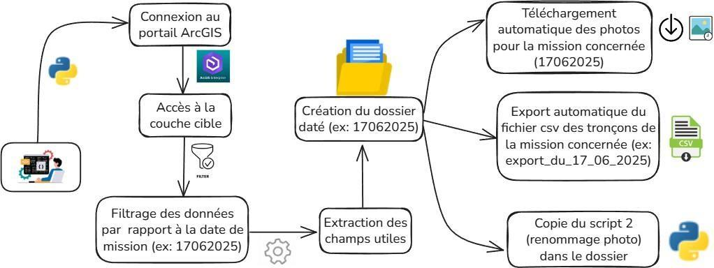

**Étape 2 — Renommage des photos**

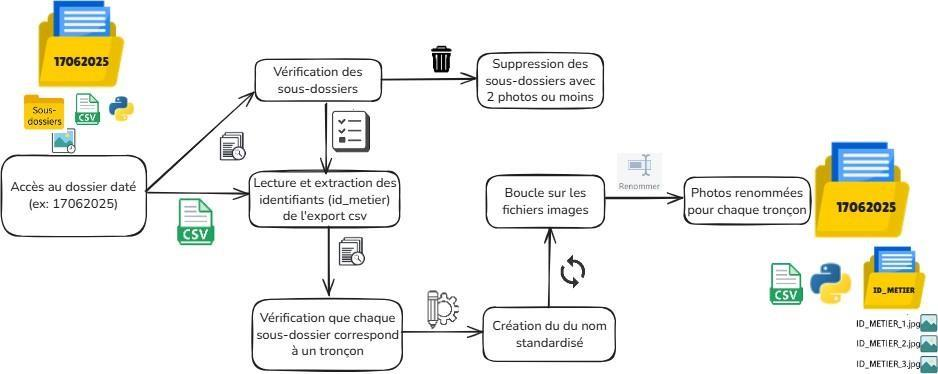

**Étape 3 — Organisation de la notation**

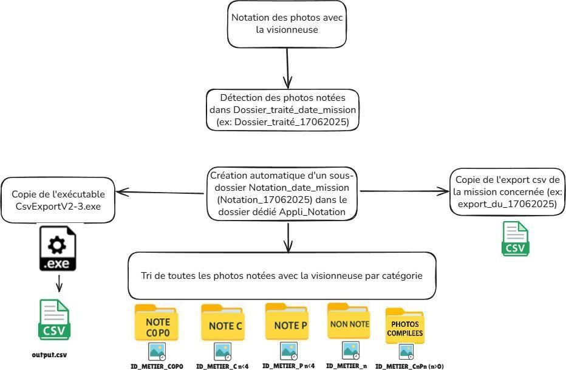

**Étape 4 — Table de correspondance**

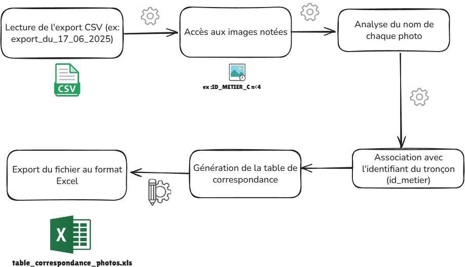

**Étape 5 — Remontée des photos dans le SIG**

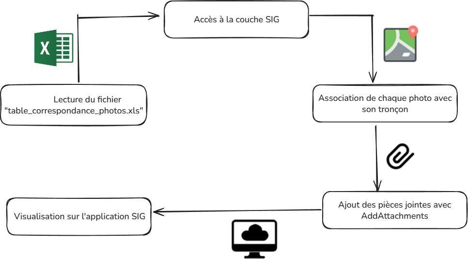

---

## 🖥️ L'interface

<table>
  <tr>
    <td width="50%">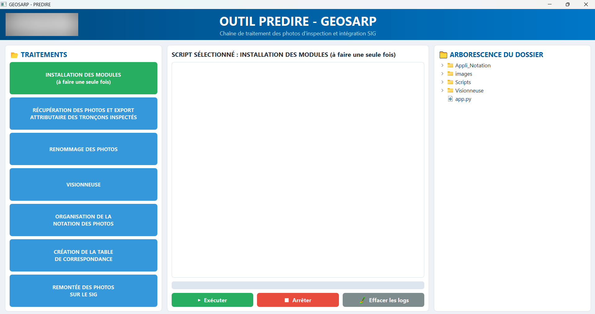</td>
    <td width="50%"></td>
  </tr>
  <tr>
    <td align="center">Écran d'accueil : les étapes dans l'ordre, à gauche</td>
    <td align="center">Installation des dépendances terminée (100 %)</td>
  </tr>
</table>

**Pensée pour des opérateurs, pas pour des développeurs :**

- **Un bouton par étape**, dans l'ordre du traitement : aucune ligne de commande.
- **Calendrier de sélection de la mission** : l'agent choisit la date de la mission à traiter. Le traitement n'est plus limité au lendemain de l'inspection, il peut se faire à tout moment.
- **Journal en temps réel** : chaque script s'exécute dans un thread séparé (`QThread`) et sa sortie s'affiche au fil de l'eau, l'interface ne se fige jamais.
- **Barre de progression** pilotée directement par les scripts.
- **Bouton d'arrêt** pour interrompre proprement un traitement en cours.
- **Arborescence du dossier** à droite pour voir immédiatement les dossiers et fichiers produits.
- **Contrôle au démarrage** : l'outil vérifie que son dossier d'installation est complet et signale ce qui manque.
- **Installation guidée** des dépendances en un clic, dans l'environnement Python d'ArcGIS Pro (pour disposer d'`arcpy`).
- **Exécutable Windows** compilé avec PyInstaller : on copie le dossier, on double-clique, ça marche, sans installer Python.

---

## 🔍 Notation des photos

Chaque photo reçoit deux notes : une note **C** pour l'encrassement (besoin de curage) et une note **P** pour les défauts structurels (besoin d'ITV).

| Note C | Encrassement | Note P | Défaut structurel |
|:-:|---|:-:|---|
| C0 | Aucun | P0 | Aucun |
| C1 | ~10 % | P1 | Mineur |
| C2 | ~25 % | P2 | Modéré |
| C3 | ~50 % | P3 | Important |
| C4 | ≥ 80 % | P4 | Grave |

  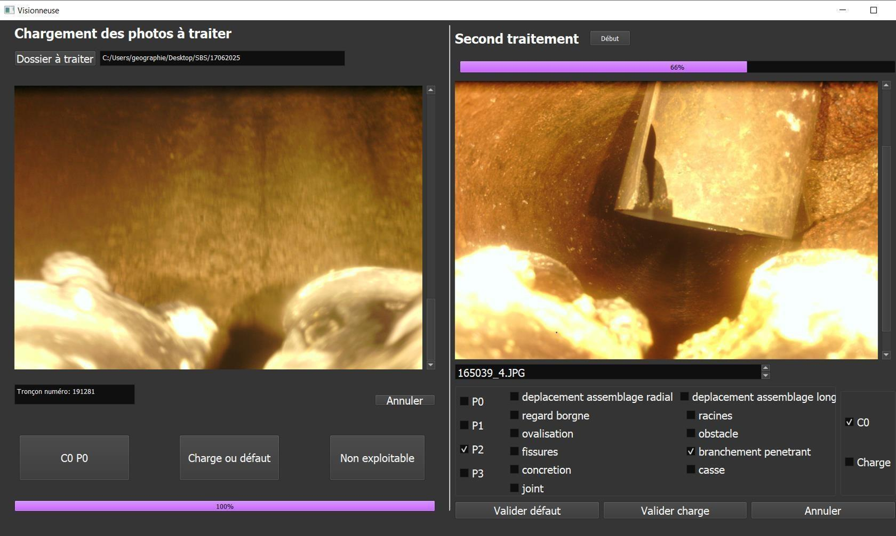
   Notation dans la visionneuse : tri rapide « sans défaut / charge / défaut », puis qualification précise (racines, fissure, obstacle, branchement pénétrant…).

**Exemples de photos prises par le drone :**

<table>
  <tr>
    <td width="25%">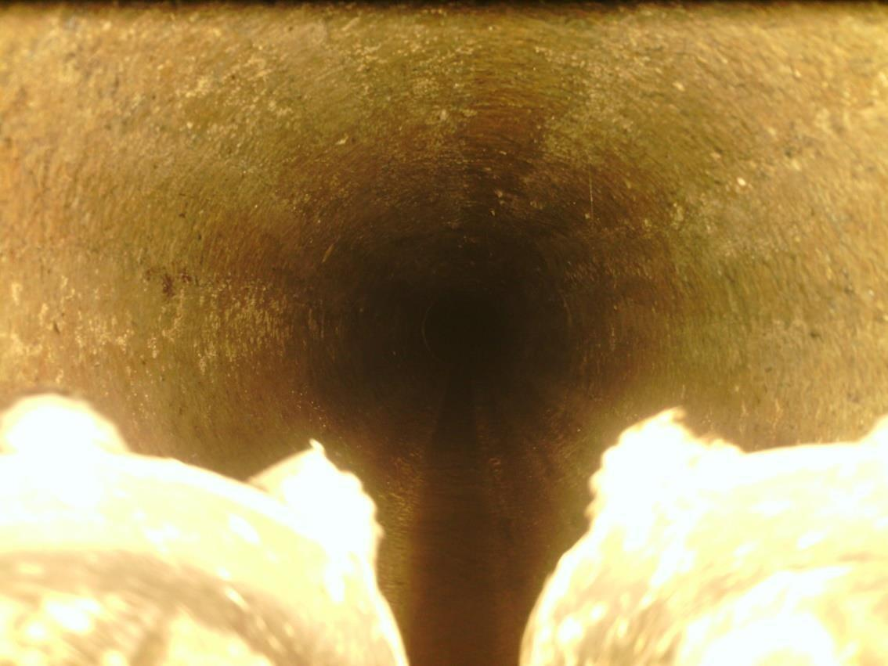</td>
    <td width="25%">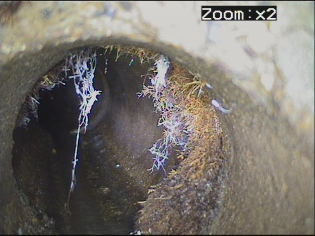</td>
    <td width="25%">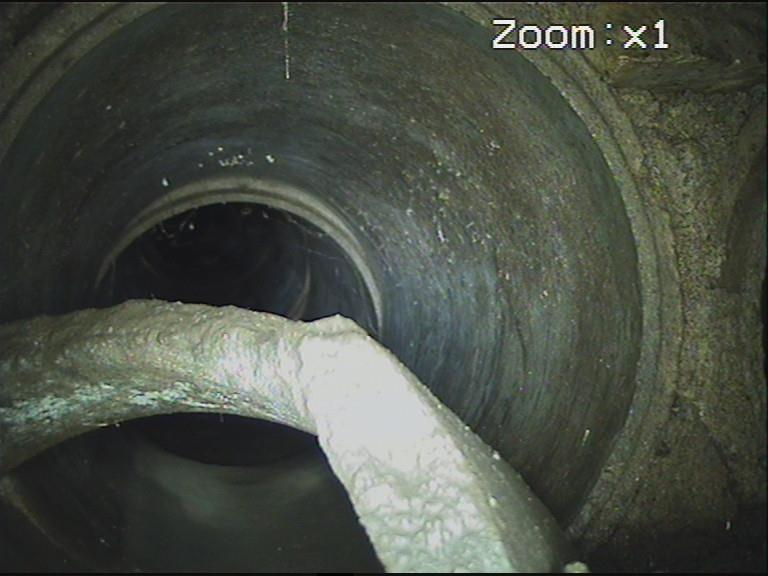</td>
    <td width="25%">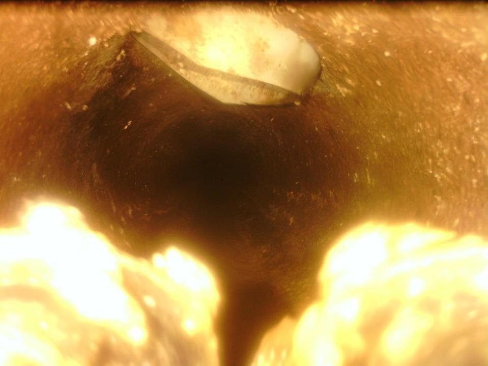</td>
  </tr>
  <tr>
    <td align="center"><b>C0 P0</b> · sans défaut</td>
    <td align="center"><b>P3</b> · racines</td>
    <td align="center"><b>P3</b> · obstacle pénétrant</td>
    <td align="center">Branchement pénétrant</td>
  </tr>
</table>

---

## 🗺️ Restitution dans le SIG

<table>
  <tr>
    <td width="26%" valign="top">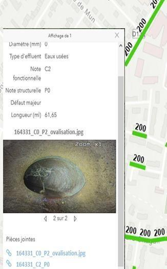</td>
    <td width="74%" valign="top">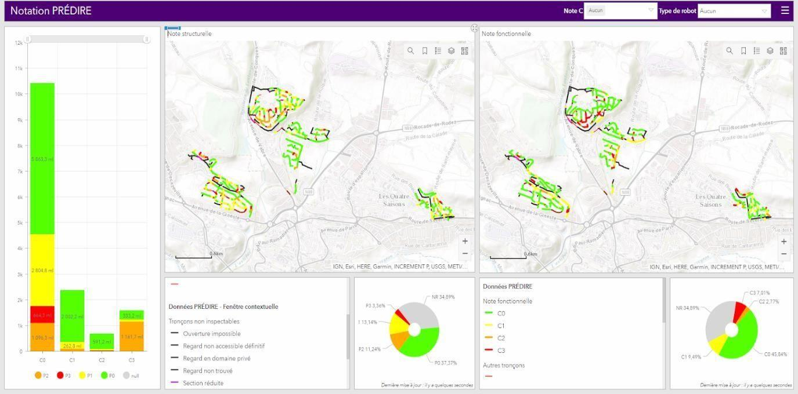</td>
  </tr>
  <tr>
    <td align="center">Clic sur un tronçon : ses notes et ses photos en pièces jointes</td>
    <td align="center">Tableau de bord ArcGIS : répartition des notes de curage et structurelles, cartes des tronçons par note</td>
  </tr>
</table>

Les gestionnaires voient en un coup d'œil **quels tronçons curer** et **lesquels envoyer en ITV**, et peuvent vérifier chaque note en ouvrant la photo correspondante.

---

## 📈 Résultats

| | Avant | Avec l'outil |
|---|---|---|
| Préparation d'une mission (photos, dossier, export des tronçons) | 1 h à 1 h 30 | **< 30 min** |
| Organisation de la notation et livrables | 30 min à 1 h | **≈ 5 min** |
| Cycle complet de production des livrables | plusieurs heures, voire une journée | **quelques dizaines de minutes** |
| Rattachement des photos aux tronçons | manuel, risque d'erreur | **automatique, avec contrôle tronçon ↔ dossier** |
| Profil requis | maîtrise de Python et des scripts | **aucune compétence technique** |

- **Livrables homogènes** : nommage standardisé, arborescence identique d'une mission à l'autre, export directement exploitable dans ArcGIS.
- **Traçabilité** : chaque export journalier est archivé automatiquement.
- **Déploiement** : l'exécutable a été diffusé dans d'autres agences, et j'ai formé les opérateurs et rédigé la documentation d'utilisation.

---

## 🧰 Stack technique

| Domaine | Outils |
|---|---|
| Interface | **Python**, **PyQt5** (`QThread`, signaux, `QFileSystemModel`) |
| Traitements | `os` / `shutil` / `re`, **pandas**, **openpyxl** |
| SIG | **arcpy** (ArcGIS Pro), **ArcGIS API for Python**, ArcGIS Enterprise (Portal, couches hébergées, pièces jointes) |
| Terrain | **ArcGIS Field Maps** (reconnaissance et lancement du drone) |
| Stockage | **API Google Drive** (OAuth 2.0) |
| Restitution | Application web ArcGIS, **ArcGIS Dashboards** |
| Distribution | **PyInstaller** (exécutable Windows autonome) |

---

## 👤 Mon rôle

- Analyse de l'existant (scripts et outils d'une autre agence) et cadrage des besoins avec le service SIG.
- Conception du workflow complet, du terrain à la carte.
- Préparation des couches et des cartes terrain **Field Maps**, accompagnement des opérateurs sur le terrain.
- Développement des scripts de traitement et de l'**interface PyQt5**.
- Intégration SIG : remontée automatique des photos, application web et tableau de bord.
- Packaging en exécutable, phases de recette avec les opérateurs, formation et documentation.

---

## 🚀 Évolutions

| Statut | Évolution |
|:-:|---|
| ✅ **Réalisé** | **Visionneuse avec notation assistée par IA** : un modèle de machine learning intégré à la visionneuse, développé avec un stagiaire de l'équipe et entraîné sur un large volume de photos déjà notées issues des campagnes. Il pré-classe automatiquement les images (sans défaut / charge / défaut) et l'opérateur valide. |
| 🔭 **À l'étude** | **Inspection multi-tronçons en continu** sur une même ligne, avec repérage automatique des regards intermédiaires. La faisabilité relève des équipes terrain. |

---

  <b>Mawa DIAW</b> · Géomaticien / Développeur SIG 
  <a href="https://www.linkedin.com/in/mawa-diaw">LinkedIn</a> · <a href="https://github.com/mawa399">GitHub</a>

